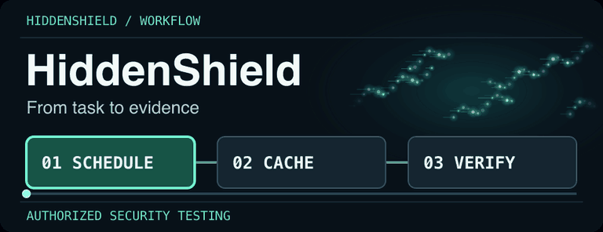
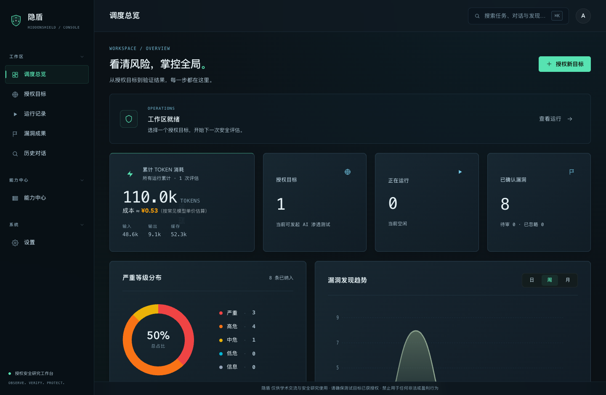
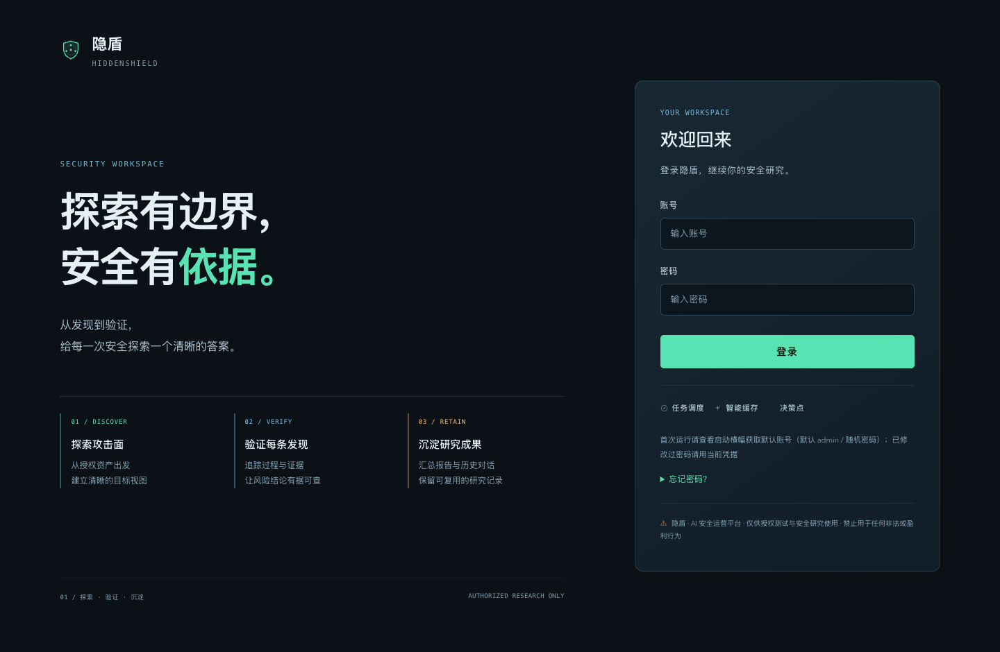
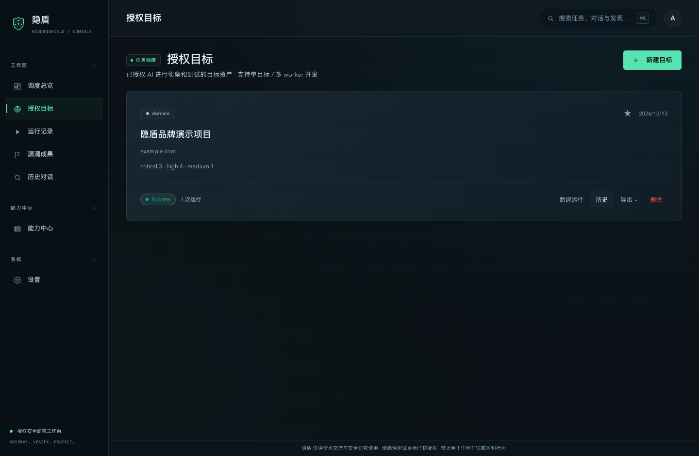
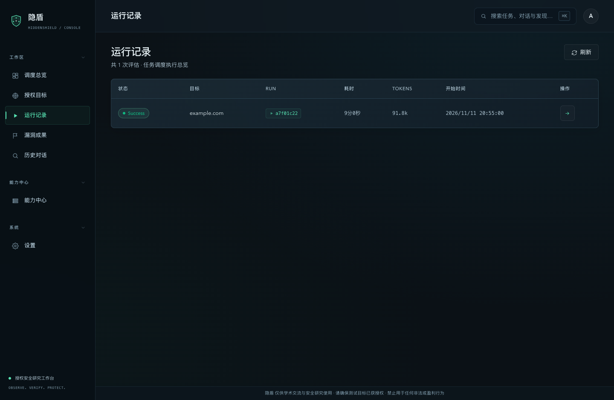
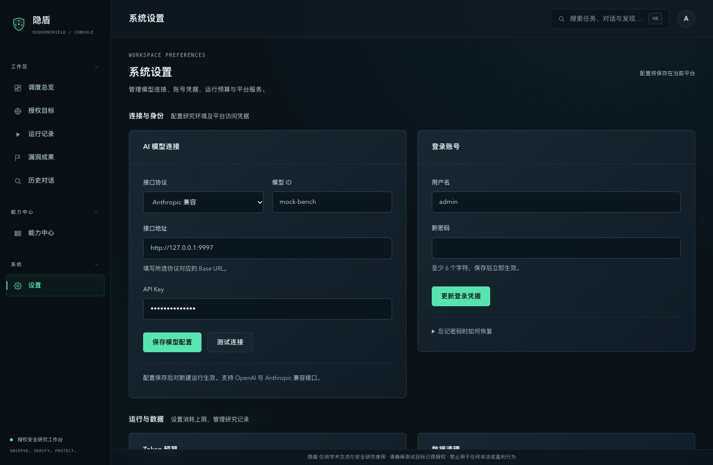
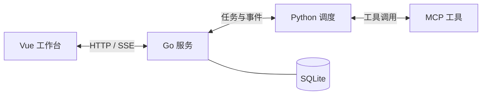

# 隐盾 · HiddenShield

面向授权安全测试的工作台。登记目标后，可在同一个界面跟踪任务进度、查看工具证据和攻击链路，并导出 Markdown 报告。

[快速开始](#快速开始) · [界面预览](#界面预览) · [工作流程](#工作流程) · [架构](#架构) · [配置](#配置) · [版本记录](CHANGELOG.md) · [静态封面](assets/readme/workflow.svg)

> 仅用于获得明确授权的测试、教学和安全研究。

## 界面预览

以下截图来自隐盾当前的本地演示实例。仓库中的启动命令仍以现有脚本名为准。



<details>
<summary>查看更多界面</summary>

### 登录



### 授权目标



### 运行记录



### 系统设置



</details>

## 工作流程

| 环节 | 平台提供的能力 |
| --- | --- |
| 任务调度 | 根据目标和范围拆分任务，由多个 Worker 并行执行，使用共享黑板记录事实和待验证事项。 |
| 智能缓存 | 记录可复用的结构化结果；具体命中情况取决于任务和模型配置。 |
| 决策验证 | 对候选发现执行复核，保存验证结果和证据，供人工判断与报告导出。 |

## 快速开始

| 平台 | 启动脚本 |
| --- | --- |
| macOS / Linux | [start-dhunter.sh](scripts/start-dhunter.sh) |
| Windows | [start-dhunter.ps1](scripts/start-dhunter.ps1) |

首次启动后访问 [本地工作台](http://127.0.0.1:13343/)，凭据见终端启动信息。完成登录后，可在系统设置中配置模型。

### 环境要求

| 依赖 | 版本 | 用途 |
|---|---|---|
| **Go** | 1.22+ | server + MCP 工具集（纯 Go 无 CGO，单静态二进制） |
| **Python** | 3.10+ | agent（黑板调度器） |
| **Node.js** | 18+ | **可选** — 仓库已带预构建 dist，无 Node 也能直接启动；改前端源码后需要重 build |
| 外部扫描器 | 可选 | 见 [外部工具依赖](#外部工具依赖可选)，缺失自动跳过 |

### 一键启动（推荐）

**macOS / Linux**

```bash
./scripts/start-dhunter.sh start
```

**Windows PowerShell**

```powershell
powershell -ExecutionPolicy Bypass -File scripts/start-dhunter.ps1 start
```

外部扫描器可按需安装，参见[外部工具依赖](#外部工具依赖可选)。

启动后打开 <http://127.0.0.1:13343/>。

**首次运行的登录账号会自动生成**，在启动横幅（终端 / 日志）中可见：

```
╔════════════════════════════════════════════════════════╗
║                       Dhunter                          ║
╚════════════════════════════════════════════════════════╝
  ONLINE  http://127.0.0.1:13343/
  ADMIN SETUP REQUIRED
    username: admin
    password: <随机生成，仅显示一次>
    token:    <随机生成>
```

登录后可在**设置 → 登录账号**里修改用户名和密码。之后每次重启登录凭据保持不变。

### 使用流程（用户视角）

1. **授权目标** → 新建目标：填目标（公司/域名/URL/IP）、目标说明、可选身份会话与红线，按需设置**并发 worker 数**
2. **启动评估** → 平台自动跑：planner 规划攻击意图 → 多 worker 并行探索 → **每落地一条漏洞立即机械重放验证**
3. **实时跟踪** → 运行详情页看 agent 思考流、工具调用、攻击图；扫到一半可 **⏸ 暂停**，之后 **▶ 继续**
4. **导出报告** → 目标卡「导出报告」一键打包该项目全部漏洞（Markdown，含 PoC/复现/证据）；运行详情也有单次 Markdown 报告

### 手动启动（从源码）

```bash
# 0. （推荐）一次性生成并导出三进程一致的 token（agent 复用平台 token）
source scripts/dev-env.sh

# 1. 构建前端（仓库已带预构建 dist，无需 Node 即可启动；改过前端源码才需要重 build）
cd frontend && npm install && npm run build && cd ..

# 2. 构建 Go 平台（server + MCP 工具）
go build -o bin/dhunter-server ./cmd/dhunter-server
go build -o bin/dhunter-mcp    ./cmd/dhunter-mcp

# 3. 启动 Python agent（黑板引擎；token 与平台一致，三进程一个标准）
cd agents
pip install -r requirements.txt
python -m core.server          # 127.0.0.1:9100
cd ..

# 4. 启动 server（自动 serve 前端 dist）
./bin/dhunter-server --config configs/dhunter.yaml   # 127.0.0.1:13343
# admin token 未配置时会自动生成随机值并持久化（横幅/日志可见）；可用
# DHUNTER_ADMIN_TOKEN 显式指定

# 5. （可选）外部扫描器
./scripts/setup-tools.sh
```

> 不用 `dev-env.sh` 也可以：只要保证 Python agent 的 `DHUNTER_AGENT_TOKEN`
> 与 Go server 的 `DHUNTER_AGENT_TOKEN` 一致（推荐都用平台 admin token），
> MCP 用独立 token 并同时传给 `dhunter-mcp -t` 与 `DHUNTER_MCP_TOKEN`。

## 外部工具依赖（可选）

Dhunter **核心服务零外部依赖**（Go 单二进制 + 进程内 HTTP）。外部扫描器是**可选的**——未安装时平台会**自动跳过并提示改用替代方法**（graceful degradation），不影响核心漏洞挖掘。

一键安装全部扫描器：

```bash
# macOS / Linux
./scripts/setup-tools.sh

# Windows
powershell -ExecutionPolicy Bypass -File scripts\setup-tools.ps1
```

安装后二进制落在 `tools/bin/`，启动脚本自动加入 PATH。也可手动安装：

| 工具 | 用途 | macOS | Windows |
|---|---|---|---|
| `httpx` | 存活 / 指纹 / 技术识别 | `go install github.com/projectdiscovery/httpx/cmd/httpx@latest` | 同左（装 Go 后） |
| `subfinder` | 被动子域枚举 | `go install github.com/projectdiscovery/subfinder/v2/cmd/subfinder@latest` | 同左 |
| `katana` | 全站爬虫 | `go install github.com/projectdiscovery/katana/cmd/katana@latest` | 同左 |
| `gau` | 历史 URL | `go install github.com/lc/gau/v2/cmd/gau@latest` | 同左 |
| `waybackurls` | Wayback URL | `go install github.com/tomnomnom/waybackurls@latest` | 同左 |
| `assetfinder` | 子域发现 | `go install github.com/tomnomnom/assetfinder@latest` | 同左 |
| `nmap` | 端口扫描 | `brew install nmap` | [官方安装包](https://nmap.org/download.html) |
| `arjun` / `uro` | 参数 fuzz / URL 去重 | `pip3 install arjun uro` | `pip install arjun uro` |

> 缺少某个扫描器不会报错——agent 会收到"[工具 xxx 未安装] 已跳过，可改用替代方法"的提示并自动换工具。

### 配置 LLM

Dhunter 兼容 Anthropic / OpenAI 协议（DeepSeek / MiniMax / Qwen / GLM / Claude…）。在**设置页**填入模型、Base URL、API Key 并测试连接，或在 `configs/dhunter.yaml` 配置：

```yaml
llm:
  provider: anthropic
  model: "deepseek-chat"
  base_url: "https://api.deepseek.com/anthropic"
  api_key: "sk-..."
```

## 架构



**运行流程**：`origin/goal 事实` 种入黑板 → planner（reason）提出攻击意图 → 多 worker 并行探索并回写事实 → 收敛 → verifier 对每条漏洞做机械重放验收 → 生成报告。worker 之间不直接通信，全靠黑板协调（stigmergy）。

## 配置

| Key | 默认值 | 说明 |
|---|---|---|
| `server.port` | `13343` | HTTP 端口 |
| `agent.python_url` | `http://127.0.0.1:9100` | Python agent |
| `agent.token` | 空 | 发给 Python agent 的 Bearer token（须与 agent 的 `DHUNTER_AGENT_TOKEN` 一致；留空=agent 无鉴权，仅本地开发） |
| `mcp.webhunter.url` | `http://127.0.0.1:9124/message` | MCP 工具端点 |
| `mcp.webhunter.token` | 空 | dhunter-mcp 的 Bearer token（设置页探测工具列表用；可由 `DHUNTER_MCP_TOKEN` 覆盖） |
| `llm.provider` | `anthropic` | `anthropic` / `openai` |
| `storage.sqlite_path` | `../data/dhunter.db` | 相对配置文件解析，跨平台 |
| `admin.username` | `admin` | 登录用户名（首启可改） |
| `admin.bootstrap_password` | 空 | 首次启动初始密码；留空则随机生成。改密码请用设置页 |
| `admin.token` | 空（自动生成） | 平台 admin Bearer token；**留空时首次启动自动生成随机值并持久化**（重启不变，横幅展示），不再有静态默认值 |

环境变量：`DHUNTER_PORT` / `DHUNTER_SQLITE_PATH` / `DHUNTER_LLM_API_KEY` /
`DHUNTER_ADMIN_TOKEN` / `DHUNTER_AGENT_TOKEN` / `DHUNTER_MCP_TOKEN` 等均可覆盖 YAML。

> **三进程一个鉴权标准**：Go server（13343）、Python agent（9100）、MCP（9124）
> 全部使用 Bearer token 鉴权（agent 侧通过 `DHUNTER_AGENT_TOKEN` 启用）。
> 登录接口带每 IP 限速（默认 10 次/分钟），防止口令爆破。

## 常用命令

```bash
./scripts/start-dhunter.sh status   # 查看三件套状态
./scripts/start-dhunter.sh stop     # 停止
./scripts/start-dhunter.sh logs     # 跟踪日志
```

> 完整更新日志请查看 [GitHub Releases](https://github.com/Dest1ny-Sec/dhunter/releases)。

## 免责声明

**隐盾是一个安全研究与教育培训工具。**

- 仅供学术交流、安全研究与技术讨论使用；
- **严禁用于任何非法活动、未授权测试或盈利行为**；
- 使用者必须确保所有测试目标已获得明确授权；
- 使用者应对自身行为及其后果承担全部责任，作者不对任何滥用行为负责。

详见 [LICENSE](LICENSE)。

## License

[非商业学术许可（Non-Commercial Academic License）](LICENSE) — 允许学术交流与安全研究使用，禁止任何商业与盈利行为。

---

<p align="center"><sub>隐盾 · 仅供学术交流与安全研究 · 请勿用于非法或盈利用途</sub></p>
